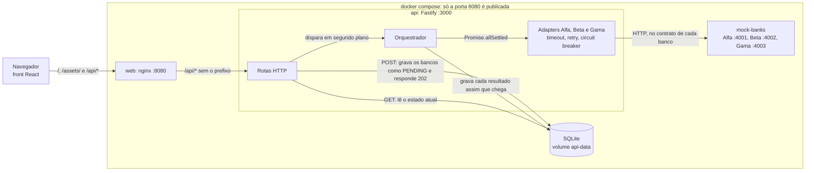

# Simulador de Empréstimo Consignado

O cliente pede uma simulação de empréstimo consignado e acompanha a resposta de três bancos
simulados, cada um com contrato, latência e falhas próprios: o sistema consulta todos em paralelo,
interpreta respostas de serviços que não controla e mostra cada uma assim que chega.

Com o Docker atualizado (veja os [pré-requisitos](#pré-requisitos)), na raiz do repositório:

```bash
docker compose up -d --build --wait
```

Depois, acesse **<http://localhost:8080>**.


Simulação enviada pelo formulário numa janela de 800 px (por isso, cards em duas colunas), contra a
API e os bancos simulados reais: o card do Banco Alfa chega em cerca de 1 s, o do Beta em 3 s, e o
Gama, forçado a falhar (`x-mock-scenario: error`, 503 com `Retry-After`), fica indisponível depois
da nova tentativa. Só para a gravação, a latência do Beta foi elevada (`BETA_LATENCY_MIN_MS=2000`,
`BETA_LATENCY_MAX_MS=2500`), para que os cards cheguem um de cada vez.

[Instruções de execução](#instruções-de-execução) · [Arquitetura](#arquitetura) ·
[Como adicionar um banco](#como-adicionar-um-banco) · [Decisões técnicas](#decisões-técnicas) ·
[Propostas](#propostas) · [Limitações](#limitações) · [Uso de IA](#uso-de-ia) ·
[Variáveis de ambiente](#variáveis-de-ambiente)

## Instruções de execução

### Pré-requisitos

- **Para rodar com Docker:** Docker Desktop atualizado (no Linux, Docker Engine com o plugin
  Compose v2). No Windows, o Docker Desktop precisa do **WSL 2**: com uma versão antiga do Docker
  Desktop ou sem o WSL 2, o motor do Docker não sobe e o `docker compose` não consegue conectar.
- **Para o modo de desenvolvimento, os testes e o smoke pelo Node:** Node 24 ou mais recente.

### Com Docker

O comando do início (`docker compose up -d --build --wait`) sobe três serviços e só devolve o
terminal quando a API e o front passam no healthcheck:

| Serviço      | O que é                                         | Porta                        |
| ------------ | ----------------------------------------------- | ---------------------------- |
| `web`        | nginx com o build do front e o proxy de `/api/` | 8080, a única aberta no host |
| `api`        | API Fastify; o SQLite fica no volume `api-data` | 3000, só na rede do compose  |
| `mock-banks` | os três bancos simulados num processo           | 4001–4003, só na rede        |

Para parar, `docker compose down`. O banco de dados sobrevive no volume; `docker compose down -v`
apaga os dados.

#### Exemplos de resultado

**Simulação A** (salário de R$ 800,00, servidor público, R$ 10.000,00 em 48 parcelas, Gama
forçado a `error`): Alfa reprova por margem, Beta faz contraproposta, Gama fica indisponível. Com
uma única oferta não há selo "Menor taxa", e o aviso de margem aparece porque a parcela estimada
não cabe.


<p>
  
  
</p>

**Simulação B** (salário de R$ 5.000,00, mesmo pedido): Alfa e Beta aprovam o valor integral; o
selo "Menor taxa" vai para o Beta (1,59% contra 1,79% ao mês).


### Modo de desenvolvimento

Na raiz do repositório, uma vez:

```bash
npm install                                # também gera o client do Prisma
npm run db:migrate -w @simulador/api       # cria o SQLite em apps/api/data
```

Depois, cada um destes num terminal próprio, também na raiz:

```bash
npm run dev -w @simulador/mock-banks       # bancos simulados nas portas 4001, 4002 e 4003
npm run dev -w @simulador/api              # API na porta 3000
npm run dev -w @simulador/web              # front em http://localhost:5173
```

O front chama a API em `/api`, na própria origem. Em desenvolvimento, o servidor do Vite repassa
`/api/*` para `API_PROXY_TARGET` (padrão `http://localhost:3000`), sem o prefixo; no Docker, o nginx
faz o mesmo. Por isso não há CORS no caminho e o `Retry-After` das respostas fica legível pelo
front.

### Forçar cenários dos bancos

A API envia headers extras a um banco quando recebe `BANK_<ID>_EXTRA_HEADERS` (JSON). Com o header
`x-mock-scenario`, o banco simulado responde o cenário pedido em vez de sortear:

```bash
BANK_GAMA_EXTRA_HEADERS='{"x-mock-scenario":"error"}' docker compose up -d --wait   # no Docker
BANK_GAMA_EXTRA_HEADERS='{"x-mock-scenario":"error"}' npm run dev -w @simulador/api # em desenvolvimento
```

| `x-mock-scenario` | O banco simulado                                   | O card mostra                                                 |
| ----------------- | -------------------------------------------------- | ------------------------------------------------------------- |
| `ok`              | responde pela regra fictícia dele                  | Aprovado, Contraproposta ou Não aprovado                      |
| `timeout`         | não responde dentro do orçamento                   | Indisponível: "O banco não respondeu a tempo."                |
| `error`           | Alfa 500; Beta 502 em HTML; Gama 503 + Retry-After | Alfa: Erro na resposta. Beta e Gama: Indisponível, após retry |
| `malformed`       | JSON quebrado                                      | Erro na resposta: "O banco retornou uma resposta inválida."   |
| `invalid-shape`   | JSON válido, fora do contrato do banco             | Erro na resposta: "O banco retornou uma resposta inválida."   |

O log da API distingue os dois últimos ("bank sent malformed JSON" e "bank response does not
match its contract", com o campo que falhou). Sem o header, os bancos simulados sorteiam falhas e
latência pelas [variáveis deles](#variáveis-dos-bancos-simulados). Para voltar ao normal no Docker,
rode o `docker compose up -d --wait` sem a variável.

### Verificação

Os comandos abaixo são de bash (no Windows, Git Bash ou WSL) e rodam na raiz do repositório.

#### Testes

```bash
npm test                  # unitários: shared, bancos simulados, API, front e o veredito do smoke
npm run test:integration  # API contra os bancos simulados por HTTP e contra um SQLite real
npm run typecheck
npm run lint
npm run format:check
```

Os testes de integração não precisam do compose: sobem os bancos simulados no próprio processo e
criam o SQLite numa pasta temporária, com as migrations reais (`prisma migrate deploy`).

#### Smoke test

Confere o sistema no ar de ponta a ponta: lê o catálogo (`GET /banks`), cria uma simulação com o
cliente fictício dos testes (nenhum dado pessoal real), acompanha o resultado por até 30 s e valida
cada resposta pelos schemas do `shared`. Termina com código 0 quando passa e 1 quando falha,
dizendo em qual passo e por quê. Com o compose no ar, de duas formas:

```bash
npm run smoke
```

```bash
docker compose --profile smoke run --rm smoke
```

A primeira usa o Node da máquina (depois do `npm install`) e chama `http://localhost:8080/api`,
passando pelo nginx; `SMOKE_BASE_URL` troca o endereço (no modo de desenvolvimento,
`http://localhost:5173/api`). A segunda roda o mesmo script num container, só com Docker.

Um banco reprovar, ficar indisponível ou devolver erro não reprova o smoke, porque os bancos
simulados sorteiam falhas. Ele falha quando o sistema falha: resposta fora do schema, simulação
que não termina no prazo, banco ainda pendente no fim, bancos diferentes dos do catálogo ou
nenhum banco com resposta de fato (aprovação ou reprovação), sinal de que os bancos simulados
podem nem ter subido.

#### Desligamento com uma simulação em andamento

Confere o [desligamento em duas fases](#desligamento-em-duas-fases) no pior caso: o Banco Gama
forçado a não responder (`timeout`), ainda em andamento durante toda a drenagem.

1. Suba o compose com a Gama em `timeout` (no PowerShell, defina antes
   `$env:BANK_GAMA_EXTRA_HEADERS='{"x-mock-scenario":"timeout"}'`):

   ```bash
   BANK_GAMA_EXTRA_HEADERS='{"x-mock-scenario":"timeout"}' docker compose up -d --wait
   ```

2. Crie uma simulação e pare a API logo em seguida, cronometrando. O `consentVersion` é o que
   `GET /api/banks` devolve; os dados são os do cliente fictício dos testes.

   ```bash
   curl -s -X POST http://localhost:8080/api/simulations -H 'content-type: application/json' -d '{"name":"Maria Teresinha Sauro","email":"maria.sauro@example.com","cpf":"52998224725","birthDate":"1985-04-12","employmentType":"PUBLIC_SERVANT","employerCnpj":"12ABC34501DE35","netSalaryCents":734219,"requestedAmountCents":1000000,"installments":48,"consent":true,"consentVersion":"2026-10-v1"}'; time docker compose stop api
   ```

   A parada precisa vir em até uns 6 s depois do POST. O orçamento da Gama é de 12 s; se sobrar
   menos que a drenagem (6 s) quando ela começa, a Gama estoura o próprio timeout durante a
   drenagem e o resultado é o do timeout normal, sem passar pelo cancelamento.

3. Confira o código de saída e o log do desligamento:

   ```bash
   docker compose ps -a --format '{{.Service}}: {{.State}}, código de saída {{.ExitCode}}' api
   docker compose logs api --since 2m
   ```

4. Religue a API e consulte a simulação, com o `id` que o POST devolveu:

   ```bash
   docker compose start api
   curl -s http://localhost:8080/api/simulations/<id>
   docker compose logs api --since 1m
   ```

5. Volte ao normal (sem a variável, o compose recria a API sem o cenário):

   ```bash
   docker compose up -d --wait
   ```

Medido em 24/10/2026, com Docker Desktop 29.9.2 no Windows 11:

| O que conferir              | Esperado                                                    | Medido                                                                                    |
| --------------------------- | ----------------------------------------------------------- | ----------------------------------------------------------------------------------------- |
| Do POST ao `stop`           | logo em seguida                                             | 0,21 s                                                                                    |
| `docker compose stop api`   | menos de 10 s                                               | 6,94 s                                                                                    |
| Código de saída da API      | 0 (137 = o Docker precisou matar o processo)                | 0                                                                                         |
| Simulação depois de religar | Gama UNAVAILABLE com "Tente novamente."; Alfa e Beta finais | Alfa e Beta APPROVED; Gama UNAVAILABLE, "O banco não respondeu a tempo. Tente novamente." |
| Log do boot seguinte        | nenhuma linha `expired PENDING bank results`                | nenhuma                                                                                   |

O log da API nessa execução, com o tempo contado a partir do SIGTERM:

| Tempo  | Linha do log                                           | O que marca                                                      |
| ------ | ------------------------------------------------------ | ---------------------------------------------------------------- |
| 0,00 s | `shutting down` (`signal: SIGTERM`)                    | início da drenagem: POST passa a responder 503, o GET continua   |
| 0,27 s | `bank answered` (Beta, APPROVED)                       | uma chamada em andamento termina dentro da drenagem              |
| 6,00 s | `bank did not answer` (Gama, `failure: ABORTED`)       | fim da drenagem (`SHUTDOWN_DRAIN_MS`): a Gama é cancelada        |
| 6,01 s | `bank calls finished` (`drained: false`, `aborted: 1`) | o resultado cancelado foi gravado                                |
| 6,02 s | `shutdown complete`                                    | HTTP e banco de dados fechados; é a última linha antes do exit 0 |

Os quase 7 s da parada são os 6 s de drenagem mais o fechamento e o tempo do próprio Docker. O
código 0 e a frase com "Tente novamente." são o que provam que o desligamento rodou. Se o sinal
não chegasse ao Node, o Docker o mataria aos 10 s (137) e, no boot seguinte, a
[expiração de PENDING](#pending-nunca-fica-para-sempre) tiraria a Gama de PENDING do mesmo jeito,
mas com outra frase ("O banco não respondeu a tempo.") e uma linha `expired PENDING bank results`
no log.

## Arquitetura



O fluxo de uma simulação:

1. O formulário carrega `GET /banks` (nome de cada banco e campos que ele recebe) para montar o
   texto do consentimento.
2. `POST /simulations` valida com o schema do `shared`, grava a simulação com todos os bancos
   `PENDING` e responde `202 { id }`.
3. Em segundo plano, o orquestrador chama todos os bancos em paralelo e grava cada resultado
   assim que ele chega.
4. O front consulta `GET /simulations/:id` até nenhum banco estar `PENDING`.

Monorepo com npm workspaces, TypeScript em modo strict em tudo:

| Pasta             | O que tem                                                                |
| ----------------- | ------------------------------------------------------------------------ |
| `packages/shared` | schemas Zod (entrada, resultados, visões da API), CPF e CNPJ, constantes |
| `apps/api`        | API Fastify, em camadas (abaixo)                                         |
| `apps/web`        | front React + Vite, servido por nginx no Docker                          |
| `apps/mock-banks` | os três bancos simulados, servidores Fastify com contratos diferentes    |
| `scripts`         | smoke test                                                               |

A API segue a regra de dependência para dentro: `http` e `infra` dependem de `application` e
`domain`, nunca o contrário. Um lint impede o `domain` de importar framework, infraestrutura ou
outra camada.

| Camada (`apps/api/src`) | Responsabilidade                                                                       |
| ----------------------- | -------------------------------------------------------------------------------------- |
| `domain/`               | regras puras: Tabela Price, margem consignável, melhor oferta, status da simulação     |
| `application/`          | casos de uso (`CreateSimulation`, `GetSimulation`), orquestrador e portas (interfaces) |
| `infra/banks/`          | um adapter por banco, que implementa `BankProvider`, e o registro de bancos            |
| `infra/http/`           | cliente HTTP com timeout, retry com backoff e circuit breaker                          |
| `infra/persistence/`    | `SimulationRepository` com Prisma sobre SQLite (e uma versão em memória para testes)   |
| `http/`                 | rotas finas: validam e chamam o caso de uso                                            |

### Bancos simulados

Os três respondem em contratos propositalmente diferentes, para que a API tenha de interpretar cada
um. As regras de aprovação, as taxas e as margens são fictícias.

| Banco | Contrato                                                                                     | Latência e falhas (padrão)                                      | Regra fictícia                                                                                                                                                                                 |
| ----- | -------------------------------------------------------------------------------------------- | --------------------------------------------------------------- | ---------------------------------------------------------------------------------------------------------------------------------------------------------------------------------------------- |
| Alfa  | `POST /v1/loan-simulations`, camelCase, `status: APPROVED \| REJECTED`                       | 50–200 ms, sem falhas sorteadas                                 | 21 a 75 anos, até 84 parcelas, parcela até 30% do salário; 1,79% a.m.                                                                                                                          |
| Beta  | `POST /api/v2/simulations`, snake_case, `result_code` numérico, dinheiro como string decimal | 300–1200 ms, 5% de 502 em HTML                                  | só servidores públicos (1,59% a.m.) e aposentados do INSS (1,66% a.m.), 18 a 80 anos; se a parcela passa de 35% do salário, contraproposta com o maior valor que cabe, a partir de R$ 1.000,00 |
| Gama  | `POST /simulate`, taxa em percentual, lista de motivos de recusa                             | 2–6 s, 20% de 503 com `Retry-After: 2` e 10% de JSON malformado | empregador fora da lista de restritos, até 80 anos no fim do contrato, parcela até 35% do salário; 1,89% a.m. até 36 parcelas, 2,05% acima; avalia todas as regras e devolve todos os motivos  |

## Como adicionar um banco

O front não conhece bancos: nome e campos vêm da API. Adicionar um banco é mexer só na API (e, para
a demonstração, nos bancos simulados):

1. **Contrato e adapter** em `apps/api/src/infra/banks/<banco>/`: o schema Zod da resposta
   (`<banco>-contract.ts`) e o adapter (`<banco>-adapter.ts`), que traduz o `SimulationInput` para o
   corpo do banco e a resposta para `BankResult`, apoiado em `common/bank-adapter.ts` (timeout,
   retry, circuit breaker, `Idempotency-Key` e validação já vêm de lá). O adapter declara
   `<BANCO>_SHARED_FIELDS`: exatamente os campos que envia.
2. **Testes do adapter:** aprovação, reprovação e resposta malformada, no mínimo. O
   `shared-fields.test.ts` passa a conferir a declaração do banco novo sozinho: muda um campo por
   vez e verifica se o corpo enviado muda.
3. **Endpoint:** o id em `BANK_IDS` e os padrões em `BANK_DEFAULTS` (`infra/banks/bank-config.ts`):
   porta, orçamento total e orçamento por tentativa. As variáveis `BANK_<ID>_*` passam a valer.
4. **Registro:** uma entrada em `BANK_REGISTRY` (`infra/banks/registry.ts`), com o nome mostrado ao
   cliente, os campos declarados e a fábrica do adapter.
5. **Consentimento:** o `consent-version.test.ts` falha, porque o texto mostrado ao cliente mudou.
   Adicione uma versão nova em `DECLARATIONS` e troque o `CONSENT_VERSION` em
   `packages/shared/src/schemas/consent.ts`; nunca edite uma versão publicada.
6. **Docker:** `BANK_<ID>_URL` no serviço `api` do `docker-compose.yml`. Para a demonstração, um
   servidor novo em `apps/mock-banks` (contrato, regras, servidor, porta em `config.ts` e o registro
   em `main.ts`).

## Decisões técnicas

### Stack e desenho

- **Fastify, e não NestJS nem Express:** traz o logger pino (com `redact`), plugins oficiais de
  helmet, CORS e rate limit e o `inject` para testar rotas sem rede, sem a injeção de dependência e
  os decorators do NestJS, que sobrariam num MVP com portas explícitas.
- **React + Vite, numa SPA:** são duas telas, sem necessidade de SEO nem de renderização no
  servidor, e o build estático vai direto para o nginx.
- **Monorepo com schemas Zod compartilhados:** front, API e smoke test validam com os mesmos
  schemas e usam os mesmos tipos, então mudar um contrato quebra o build de quem o usa.
- **SQLite + Prisma atrás de `SimulationRepository`:** nenhum serviço a mais para subir, migrations
  versionadas, e a porta permite trocar por PostgreSQL e usar uma versão em memória nos testes.
- **Bancos simulados como servidores HTTP separados, e não funções mockadas:** timeouts, retry,
  circuit breaker e validação de contrato são exercitados com latência, 5xx e JSON malformado
  reais, nos testes de integração e na demonstração.
- **Polling, e não SSE nem WebSocket:** uma simulação dura no máximo uns 22 s, e cada consulta é
  uma requisição sem estado, que passa por qualquer proxy, sobrevive a um reinício da API e
  respeita o rate limit e o `Retry-After`.
- **Vitest:** um só executor de testes em TypeScript para todos os pacotes, integrado ao Vite no
  front, sem configuração de transpilação.

### CNPJ alfanumérico

O CNPJ é validado pelo dígito verificador e aceita o **formato alfanumérico** que a Receita Federal
emite desde julho de 2026: as 12 primeiras posições podem ter letras, os dois dígitos verificadores
são numéricos, e o módulo 11 usa como valor de cada caractere o código ASCII menos 48 (`0`–`9`
valem 0–9, `A`–`Z` valem 17–42). O CNPJ só numérico continua válido pelo mesmo cálculo, sem caminho
separado. O CPF usa o mesmo módulo 11 (`mod11CheckDigit`).

- **A máscara remove só `.`, `/`, `-` e espaço.** Qualquer outro caractere invalida o documento,
  em vez de ser descartado em silêncio.
- **Só `a`–`z` viram maiúsculas.** O `toUpperCase` do JavaScript transformaria `ß` em `SS` e o `ı`
  sem ponto em `I`, produzindo um CNPJ com cara de válido.
- **Sequências repetidas são recusadas**, mesmo quando o dígito verificador fecha.
- **O front usa as mesmas regras**: a máscara de CPF e CNPJ aceita só o que o `shared` aceita.

### Dinheiro em centavos

Todo valor monetário é um inteiro em centavos, nos schemas, no banco de dados e entre os serviços.
O teto do valor pedido e do salário é R$ 1.000.000,00, o que também mantém os valores dentro das
colunas inteiras de 32 bits do banco de dados.

- **Tabela Price:** a parcela calculada em ponto flutuante é arredondada a 1e-6 centavo antes do
  arredondamento comercial (half-up) para o centavo. Sem isso, um valor como `1.4999999999999998`
  viraria 1 em vez de 2.
- **Bancos que mandam dinheiro como texto** (o Beta, `"5000.00"`) são convertidos separando a
  string, sem passar por float.
- **No front**, a formatação divide um `BigInt` e entrega uma string decimal ao `Intl`: `cents /
100` erra em valores altos.

### Margem consignável: a API informa, não bloqueia

A API estima a margem consignável (`MARGIN_PERCENT` do salário líquido, fictício e configurável) e
a parcela do valor pedido a uma taxa de referência fictícia (`MARGIN_REFERENCE_MONTHLY_RATE`).
Essa estimativa serve apenas para **informar** o cliente: a simulação é sempre enviada aos bancos.

- A estimativa não conhece os descontos que o cliente já tem em folha, o percentual real por tipo
  de vínculo nem a taxa de cada banco. Bloquear com base nela geraria falsos negativos definitivos.
- Bloquear eliminaria contrapropostas: um banco pode aprovar um valor menor que cabe na margem.
- Os bancos são a autoridade sobre a aprovação; o objetivo do sistema é interpretar as respostas
  deles.

Quando a parcela estimada não cabe, o front mostra um aviso sem valores (o `GET` só devolve
`fitsMargin`, veja [dados pessoais](#dados-pessoais-e-logs)):

> Pela nossa estimativa, a parcela deste pedido pode não caber na sua margem consignável. É apenas
> uma referência: cada banco faz a própria avaliação e dá a resposta final.

### Melhor oferta: menor taxa mensal

A melhor oferta é a de **menor taxa mensal** entre as aprovadas, incluindo contrapropostas. A
parcela não é critério: uma contraproposta tem parcela menor só porque empresta menos dinheiro.
Desempates, em ordem: valor integral antes de contraproposta, maior valor aprovado e, por fim,
`bankId` em ordem alfabética, para que o resultado não dependa da ordem de chegada das respostas.
As taxas são comparadas em micro-unidades (1e-6), nunca com `===` entre floats.

### Integração com os bancos

Cada banco tem um adapter que implementa a porta `BankProvider`. O adapter **nunca rejeita**: toda
falha vira um resultado, e a falha de um banco nunca afeta os outros.

- **Contrato validado com Zod.** A resposta de cada banco passa pelo schema do contrato dele; o que
  não passa vira `ERROR`, nunca exceção solta. Campos extras que o banco venha a adicionar são
  tolerados.
- **`UNAVAILABLE` × `ERROR`.** `UNAVAILABLE` quando o banco não respondeu (timeout, rede, 502, 503,
  504, circuit breaker aberto, cancelamento no desligamento); `ERROR` quando respondeu errado (JSON malformado, fora do contrato,
  4xx, outro 5xx, redirecionamento).
- **Timeout por tentativa e por consulta**, com `AbortController`, dimensionados pela latência de
  cada banco (veja as [variáveis](#variáveis-da-api)).
- **Retry por lista de permissão.** Só se tenta de novo o que é transitório: timeout da tentativa,
  erro de rede e os status 502, 503 e 504. Qualquer outro resultado, inclusive um tipo de falha
  criado no futuro, não é repetido até alguém decidir que deve ser. Sem `Retry-After`, a espera é
  um backoff exponencial com _full jitter_; com `Retry-After`, é **exatamente** o valor pedido pelo
  banco, desde que caiba no tempo restante da consulta.
- **Circuit breaker próprio, um por banco.** Conta falhas consecutivas por consulta (5xx, timeout e
  rede contam; 4xx conta como sucesso, porque o banco está de pé). Aberto, recusa na hora com
  `attempts: 0`. Depois de `BANK_BREAKER_OPEN_MS`, deixa passar uma chamada de teste
  (`HALF_OPEN`): sucesso fecha; falha reabre e reinicia o tempo; cancelamento volta a aberto sem
  reiniciar o tempo, para nunca ficar preso em `HALF_OPEN`.
- **`Idempotency-Key: <simulationId>:<bankId>`** em todas as tentativas, para o banco reconhecer um
  retry da mesma consulta.
- **`fetch` com `redirect: 'manual'`.** Um 3xx vira `ERROR`: os dados pessoais nunca são reenviados
  a outro endereço.
- **Headers extras só por variável de ambiente** (`BANK_<ID>_EXTRA_HEADERS`), vazios por padrão e
  nunca preenchidos com dado do cliente; os headers que o adapter define não podem ser sobrescritos.

### Resultado assíncrono: 202 e polling

O `POST` responde `202` assim que grava a simulação, e o resultado de cada banco é gravado numa
linha própria assim que chega. A gravação é condicional (`PENDING` → final): o primeiro resultado
final vence, e respostas simultâneas nunca se sobrescrevem.

#### PENDING nunca fica para sempre

Um banco ainda `PENDING` depois do maior orçamento entre os bancos mais uma folga
(`SIMULATION_PENDING_TTL_MS`, padrão 22 s) vira `UNAVAILABLE`, em dois momentos: no `GET` (o cliente
nunca vê um PENDING eterno) e ao iniciar a API (limpa o que um processo anterior deixou). Como a
gravação é condicional, um resultado real que chegue ao mesmo tempo prevalece.

#### Hora do servidor e nome dos bancos vêm da API

- **`serverTime` no `GET /simulations/:id`.** O tempo decorrido é medido contra o relógio do
  servidor, o mesmo que gravou `createdAt`. O front calcula, a cada resposta, a diferença entre o
  relógio do servidor e o do navegador, que pode estar minutos errado.
- **`bankName` em cada resultado**, vindo do registro de bancos. Um banco removido do registro
  aparece pelo id nas simulações antigas.

#### Teto único para o Retry-After

`MAX_RETRY_AFTER_MS` (60 s), no `packages/shared`, é o maior `Retry-After` que o front aceita entre
duas consultas, e a API recusa no boot uma `RATE_LIMIT_WINDOW_MS` maior, porque o `Retry-After` de
um 429 dura até o fim da janela. Assim, um `Retry-After` legítimo da API nunca é cortado; o teto só
corta valores que não vieram dela (um proxy mal configurado, por exemplo). Ele também protege o
`setTimeout`: acima de 2³¹ − 1 ms, ou com `Infinity`, o timer dispara na hora, e o polling entraria
em loop justamente contra um servidor que pediu para esperar. Um teste da rota roda com a janela
máxima e confere que o `Retry-After` do `@fastify/rate-limit` cabe no teto.

### Dados pessoais e logs

O `SimulationInput` completo existe **só em memória**, durante a consulta aos bancos. No banco de
dados ficam apenas:

| Dado                                    | Gravado?            | Por quê                                                                        |
| --------------------------------------- | ------------------- | ------------------------------------------------------------------------------ |
| CPF                                     | Só mascarado        | `***.982.247-**` permite ao cliente reconhecer a simulação, não identificá-lo  |
| Nome e e-mail                           | Não                 | Exigidos pelo enunciado, mas nenhum banco os recebe: validados e descartados   |
| Nascimento, vínculo, CNPJ do empregador | Não                 | Só os bancos usam                                                              |
| Salário líquido                         | Não                 | —                                                                              |
| Margem e parcela estimadas              | Sim, nunca expostas | Junto com o percentual revelam o salário exato: não saem no `GET` nem nos logs |
| Valor pedido e parcelas                 | Sim                 | Identificar contraproposta e mostrar o resultado                               |
| Momento e versão do consentimento       | Sim                 | Comprovar a base legal da consulta e a qual texto o cliente concordou          |
| Resultados dos bancos                   | Sim                 | É o produto                                                                    |

O `GET /simulations/:id` não tem autenticação: o UUID aleatório é a única chave. Por isso ele
devolve, da avaliação de margem, **só** `fitsMargin`. Margem, parcela estimada ou percentual de
comprometimento permitiriam recalcular o salário a partir do valor pedido e da configuração
pública. Um teste confere que salários diferentes, do mesmo lado do limite da margem, produzem a
mesma seção de margem: o que a própria API calcula não revela o salário além de `fitsMargin`. Os
resultados dos bancos, que o `GET` também devolve, ainda permitem inferi-lo (veja as
[limitações](#outras-limitações)).

Logs: sem corpo de requisição, sem headers, sem IP do cliente, e com `redact` do pino para CPF,
nome, e-mail, nascimento, salário, CNPJ, margem e parcela estimada, no topo do objeto logado e
até dois níveis abaixo. O `simulationId` liga os logs da requisição aos dos bancos. No front, nada
é gravado no navegador: o rascunho do formulário fica só em memória.

### Consentimento: quais dados vão para quais bancos

O formulário monta o texto do consentimento a partir de `GET /banks`, que devolve a versão vigente
do texto (`CONSENT_VERSION`) e, por banco, o nome e os campos que ele recebe:

| Banco      | Recebe                                                                                                                         |
| ---------- | ------------------------------------------------------------------------------------------------------------------------------ |
| Banco Alfa | CPF, data de nascimento, tipo de vínculo (se informado), CNPJ do empregador, salário líquido, valor pedido, número de parcelas |
| Banco Beta | Os mesmos dados do Banco Alfa                                                                                                  |
| Banco Gama | Os mesmos, sem o tipo de vínculo (o contrato do Gama não tem esse campo)                                                       |

Nome e e-mail não vão para nenhum banco e não são gravados.

- **A lista é declarada por cada adapter**, ao lado da tradução do corpo. Um teste confere a
  declaração pelo comportamento: muda um campo por vez e verifica se o corpo enviado ao banco muda.
  Campo enviado e não declarado, ou declarado e não enviado, quebra a suíte.
- **O front devolve a versão do texto que mostrou** (`consentVersion`) e o schema só aceita a
  vigente. Uma aba aberta antes de um deploy que mudou o texto recebe 400 pedindo para recarregar,
  em vez de gravar o aceite de um texto que o cliente não leu.
- **Mudar o nome de um banco ou seus campos exige versão nova.** Um teste guarda a declaração de
  cada versão e falha se a declaração mudar sem versão nova. Protege contra esquecimento, não contra
  má-fé: nada impede editar a entrada de uma versão já publicada.

### Front-end

- **Sem bibliotecas de formulário nem de requisição.** O formulário tem estado próprio: no
  react-hook-form, as máscaras exigiriam `Controller` em metade dos campos, e o schema do shared
  valida o `SimulationInput`, não o estado da tela. O polling é um hook próprio: o
  `refetchInterval` do TanStack Query é um `setInterval`, e aqui a regra é nunca ter duas
  requisições em andamento. Estilo com CSS Modules e tokens (`tokens.css`), sem biblioteca de
  componentes: a acessibilidade fica no código do projeto, não dentro de uma dependência.
- **Cliente da API que nunca rejeita.** Cada chamada devolve um resultado discriminado (`ok`,
  `validation`, `rate-limited`, `unavailable`, `not-found`, `network`, `unexpected` ou `aborted`),
  como o `BankProvider` faz com os bancos. Toda resposta passa pelo schema do shared; o que não
  passa vira `unexpected`. Cada requisição tem timeout de 10 s.
- **Polling encadeado.** Cada resposta agenda a próxima consulta, então nunca há duas ao mesmo
  tempo e uma resposta lenta adia a seguinte em vez de empilhar requisições. Espera: 1 s no caminho
  normal; 1, 2, 4 e 8 s após falhas seguidas; com `Retry-After` (429 ou o 503 do desligamento), o
  valor pedido, com piso de 1 s e o [teto único](#teto-único-para-o-retry-after). O polling para
  quando nenhum banco está `PENDING` ou num 404. Ao sair da página, o timer é cancelado e a
  requisição em andamento é abortada.
- **Uma falha no polling não apaga o resultado.** Em erro de rede, 5xx, 429 ou resposta inválida,
  a tela mantém o último estado e mostra um aviso neutro ("Não foi possível atualizar o resultado
  agora. Tentando novamente…"): num 429 ou num 5xx a conexão do cliente está boa, e o aviso não
  deve culpá-la.
- **Cards por banco, na ordem da API.** Cada estado tem cor, ícone e texto (Aguardando resposta,
  Aprovado, Contraproposta, Não aprovado, Indisponível, Erro na resposta): nenhum depende só de
  cor. A contraproposta tem destaque próprio ("R$ X de R$ Y pedidos"), e o motivo que a API dá
  (`reason`) aparece sempre que vier.
- **Selo "Menor taxa" só no fim e com duas ofertas ou mais.** Durante a consulta, o `bestOffer`
  é a melhor oferta até aquele momento; mostrar o selo antes faria ele pular de banco quando um
  mais lento responde. Com uma única oferta não há o que comparar.
- **Resumo: "não" é diferente de "não sei".** A frase só afirma o que as respostas dos bancos
  sustentam, e o link de volta ao formulário muda conforme o caso:

  | Situação                                    | Resumo                                                                                                          | Link                      |
  | ------------------------------------------- | --------------------------------------------------------------------------------------------------------------- | ------------------------- |
  | Consultando                                 | "Consultando os bancos: 2 de 3 responderam."                                                                    | —                         |
  | Duas ofertas ou mais                        | "2 ofertas recebidas. A menor taxa é do Banco Beta."                                                            | Ajustar e simular de novo |
  | Uma oferta                                  | "1 oferta recebida, do Banco Beta."                                                                             | Ajustar e simular de novo |
  | Sem ofertas, algum banco reprovou           | "Nenhum banco aprovou o pedido."                                                                                | Ajustar e simular de novo |
  | Algum banco sem resposta, nos 3 casos acima | O texto do caso + "Nem todos os bancos responderam: simular novamente pode trazer a resposta dos que faltaram." | Simular novamente         |
  | Nenhum banco respondeu                      | "Nenhum banco respondeu. Simular novamente pode trazer as respostas."                                           | Simular novamente         |
  | Simulação inexistente ou expirada (404)     | "Simulação não encontrada ou expirada."                                                                         | Fazer uma nova simulação  |

- **Leitor de tela.** Uma região `aria-live` existe vazia desde o primeiro render (uma região que
  nasce junto com o texto não é anunciada). Ela anuncia o resumo na primeira resposta, cada banco
  que responde ("Banco Beta: contraproposta.") e, no fim, o resumo. O contador de segundos fica
  fora dela. O aviso de falha é `role="alert"` e, vazio, nunca usa `display: none`, que o tiraria
  da árvore de acessibilidade. Ao trocar de rota, o foco vai para o `<h1>` da página.
- **Rascunho só em memória.** "Simular novamente" volta ao formulário preenchido, mas pede o
  consentimento de novo, e nada é gravado no navegador: CPF e salário não ficam no `localStorage`.

### Desligamento em duas fases

Ao receber `SIGTERM`: (1) a API deixa de aceitar novas simulações (`POST` responde 503 com
`Retry-After`) e espera as consultas em andamento por até `SHUTDOWN_DRAIN_MS`; o `GET` continua
respondendo; (2) cancela o que restou, gravando "O banco não respondeu a tempo. Tente novamente.",
e espera até `SHUTDOWN_ABORT_GRACE_MS` por essas gravações. A soma é validada no boot para caber
nos 10 s do `docker stop`, e o compose deixa o `stop_grace_period` explícito em 10 s. Por fim, a
API registra `shutdown complete` e só sai depois de o logger esvaziar o buffer (o stdout do pino é
assíncrono, e a última linha poderia se perder no `process.exit`). A
[verificação](#desligamento-com-uma-simulação-em-andamento) mostra os números medidos.

### Empacotamento com Docker

Um único `Dockerfile`, na raiz, gera uma imagem por serviço (targets `api`, `mock-banks`, `web` e
`smoke`), com builds em estágios e usuário sem privilégio de root.

- **Base glibc:** `node:24.14.1-trixie-slim` (328 MB), não Alpine: o better-sqlite3 e o motor de
  migrações do Prisma são binários nativos pré-compilados para glibc. A imagem slim não traz
  `libssl`, que o motor de migrações exige, por isso o `openssl` é instalado.
- **API, 864 MB, com o CLI do Prisma.** A cada boot, a API roda `prisma migrate deploy` antes de
  subir o servidor (`prisma` fica em `dependencies`). O CLI responde por cerca de 150 MB: o pacote
  `prisma` com as dependências que ficam junto dele (87 MB), o Prisma Studio (43 MB) e o motor de
  migrações (24 MB). O servidor não usa nenhum deles. A alternativa seria um serviço `migrate` de
  execução única no compose, com a API esperando por ele (`depends_on` com `condition:
service_completed_successfully`) numa imagem sem o CLI. O custo é a garantia: com a migração no
  comando da própria API, qualquer forma de subir a imagem migra antes de servir; com o serviço à
  parte, quem sobe só a API pode apontá-la para um banco sem as migrações.
- **`exec` no comando da API.** O comando é `sh -c "prisma migrate deploy && exec node dist/main.js"`:
  com o `exec`, o Node substitui o shell como PID 1 e recebe o `SIGTERM` do Docker. Sem ele, o shell
  receberia o sinal e não o repassaria.
- **Bancos simulados, 385 MB.** Eles representam serviços de outra empresa (nem importam o
  `shared`), então a imagem leva só as dependências de produção deles: um `npm ci --omit=dev`
  restrito ao workspace, com 51 MB de `node_modules` em vez dos 326 MB do monorepo inteiro.
- **O nginx** (imagem sem root, versão estável) serve o build do front e repassa `/api/` para a
  API. Ele resolve o endereço da API a cada requisição (`resolver` do Docker e o endereço numa
  variável), então sobe sem a API e a acompanha se o container for recriado. O `X-Forwarded-For` é
  sobrescrito com o IP que o nginx viu, nunca acrescentado (veja as
  [limitações](#rate-limit-contra-ip-forjado-uma-camada-só)). Os arquivos de `/assets/` têm cache
  imutável (o nome tem hash) e dão 404 quando não existem; as outras rotas recebem o `index.html`,
  sempre revalidado, para que um deploy chegue ao navegador. Respostas do front levam
  `X-Content-Type-Options`, `Referrer-Policy: no-referrer` (a URL do resultado carrega o UUID, que é
  a chave de acesso) e uma Content-Security-Policy restrita à própria origem. Para caber nessa CSP,
  o Zod roda sem JIT no front (`jitless`): o teste que ele faz de `eval` seria bloqueado e
  registraria uma violação no console.
- **Healthchecks.** O `GET /health` da API confere o banco de dados com uma consulta simples, mas
  nunca os bancos: a API continua saudável sem eles, coerente com a resiliência. Não tem rate limit
  e não aparece no log a cada checagem. O do front confere só o nginx e o build, nunca a API.

## Propostas

### Implementadas

Além do que o enunciado pediu, organizadas por quem se beneficia.

#### Cliente: resultado progressivo, sem espera infinita

- **Problema:** os bancos levam de décimos de segundo a vários segundos, e um deles pode nunca
  responder. Uma resposta única faria o cliente esperar o mais lento, ou para sempre.
- **Proposta:** o `POST` responde `202` na hora e o front acompanha por polling; cada banco ganha
  um card assim que responde; um banco que passa do prazo vira indisponível
  ([PENDING nunca fica para sempre](#pending-nunca-fica-para-sempre)); o tempo decorrido usa a
  [hora do servidor](#hora-do-servidor-e-nome-dos-bancos-vêm-da-api).
- **Por quê:** o cliente vê cada resposta no momento em que ela existe, e nenhuma espera é infinita.

#### Cliente: "não aprovou" é diferente de "não respondeu"

- **Problema:** "nenhuma oferta" pode significar que os bancos reprovaram ou que não responderam.
  Tratar os dois casos igual leva o cliente a desistir quando bastava tentar de novo, ou a repetir
  quando nada mudaria.
- **Proposta:** o `GET` informa `retryable` (algum banco ficou indisponível ou com erro); o
  [resumo](#front-end) só afirma o que as respostas sustentam; o link de volta ao formulário é
  "Simular novamente", em destaque, quando faltou resposta, e "Ajustar e simular de novo" quando
  todos responderam; e "Nenhum banco respondeu" tem frase própria.
- **Por quê:** o próximo passo sugerido é sempre o que tem chance de mudar o resultado.

#### Empresa: integração isolada e resiliente

- **Problema:** os bancos são serviços de terceiros, com contratos diferentes, lentos, instáveis e
  às vezes com respostas malformadas. Sem isolamento, a falha de um derruba a simulação inteira, e
  cada banco novo mexe no resto do sistema.
- **Proposta:** um adapter por banco com o contrato validado, timeout por tentativa e por consulta,
  retry só em falhas transitórias, circuit breaker por banco, `Idempotency-Key` em cada tentativa
  ([integração com os bancos](#integração-com-os-bancos)) e um
  [teto único para o Retry-After](#teto-único-para-o-retry-after).
- **Por quê:** a falha de um banco vira um card, nunca uma exceção que derruba a simulação ou os
  outros bancos; um banco fora do ar deixa de ser chamado até se recuperar; e adicionar um banco é
  um adapter e uma entrada no registro ([como adicionar](#como-adicionar-um-banco)).

#### Empresa: proteção de dados

- **Problema:** a simulação envolve CPF e salário, e o `GET` do resultado não tem autenticação: o
  UUID é a única chave.
- **Proposta:** [minimização](#dados-pessoais-e-logs) do que é gravado; `GET` que expõe da
  avaliação de margem só `fitsMargin`; logs com `redact` e sem corpo nem IP; e
  [consentimento por banco, com versão](#consentimento-quais-dados-vão-para-quais-bancos), com
  testes que travam a declaração de campos e a versão do texto.
- **Por quê:** guardar só o necessário e dizer a cada banco exatamente o que ele recebe é o que a
  LGPD pede (finalidade, necessidade e transparência), e o que a própria API calcula não ajuda
  quem tiver o link a reconstruir o salário. Os resultados dos bancos ainda permitem inferi-lo,
  uma [limitação](#outras-limitações) com evolução prevista.

### Planejadas

Em ordem de prioridade.

#### 1. Idempotência no POST de simulação

- **Problema:** um reenvio do `POST /simulations` depois de uma falha de rede cria outra simulação.
- **Proposta:** o front gera uma chave por envio, e a API devolve a mesma simulação se ela repetir.
- **Por quê:** hoje uma falha de rede comum basta para consultar todos os bancos duas vezes.

#### 2. Retenção de dados

- **Problema:** nada é apagado, nem a margem e a parcela estimadas, que revelam o salário.
- **Proposta:** apagar a simulação após um prazo; o `GET` responde 404, que o front já trata.
- **Por quê:** a LGPD pede guardar só pelo tempo necessário, e o link deixa de valer para sempre.

#### 3. Métricas e alertas por banco

- **Problema:** um banco ficando lento ou instável só aparece nos logs.
- **Proposta:** latência, taxa de falha e estado do circuit breaker por banco, com alertas.
- **Por quê:** sem esses números não dá para calibrar timeouts e circuit breaker com dados reais.

#### 4. Tentar de novo só um banco (R3)

- **Problema:** "Simular novamente" consulta de novo até os bancos que já responderam.
- **Proposta:** retry de um banco só; o front reenvia os dados, e a API os confere por um HMAC.
- **Por quê:** no mundo real, cada consulta pode ficar registrada em bureaus de crédito.

#### 5. Processamento durável e várias instâncias

- **Problema:** as consultas vivem na memória do processo, preso a [uma instância](#uma-instância-só).
- **Proposta:** fila durável, PostgreSQL e estado compartilhado de circuit breaker e rate limit.
- **Por quê:** um processo que cai não perde consultas, e a API passa a escalar horizontalmente.

#### 6. Link da simulação por e-mail

- **Problema:** o e-mail é exigido pelo enunciado, mas hoje só é validado e descartado.
- **Proposta:** enviar o link do resultado, guardando o e-mail só até o envio e com consentimento.
- **Por quê:** o cliente volta ao resultado depois; o link expira junto com a retenção (2).

## Limitações

### Uma instância só

A API foi feita para rodar como uma instância. As consultas aos bancos rodam em segundo plano na
memória do processo: se ele cair no meio, as chamadas em andamento se perdem, e os bancos ficam
indisponíveis pela [expiração de PENDING](#pending-nunca-fica-para-sempre). O circuit breaker e o
rate limit também vivem na memória, por processo, e o SQLite aceita um escritor por vez. A
proposta [5](#5-processamento-durável-e-várias-instâncias) resolve isso.

### Rate limit contra IP forjado: uma camada só

O rate limit conta as requisições por IP do cliente (padrão: 10 POSTs por minuto). Atrás do
nginx, a API lê esse IP do `X-Forwarded-For` (`TRUST_PROXY=true`), e a proteção contra um IP
forjado nesse cabeçalho depende de duas condições:

- **O nginx sobrescreve o `X-Forwarded-For`** com o endereço que ele viu (`$remote_addr`), em vez
  de acrescentar. Dois testes provam isso. Pelo nginx do compose, 11 POSTs, cada um com um IP
  forjado diferente, levam o 11º a 429: o contador é um só. Num nginx que acrescenta
  (`$proxy_add_x_forwarded_for`), 15 POSTs iguais passam sem nenhum 429, porque cada IP forjado
  ganha um contador novo.
- **O nginx é o único caminho até a API:** a porta dela não é publicada no host. Quem chegasse
  direto poderia mandar qualquer `X-Forwarded-For`.

Uma segunda camada seria a API confiar só no IP do nginx (`trustProxy` com o endereço dele).
Confiar na sub-rede inteira do compose não adiantaria: o nginx vê o host como o gateway dessa
mesma rede. Seria preciso fixar uma sub-rede e o IP do nginx no compose, e uma sub-rede fixa pode
colidir com redes já existentes na máquina de quem roda o projeto; por isso ficou de fora. Em
produção, a lista de proxies confiáveis viria da infraestrutura.

Confiar num número de saltos (`trustProxy: 1`) não é alternativa: o Fastify (5.12.7, a versão
usada) desativou essa opção porque ela não confere quem é o vizinho imediato, e um cliente que
chegasse direto à API forjaria o IP.

### Outras limitações

- **`POST` não idempotente.** Um reenvio depois de uma falha de rede cria outra simulação (proposta
  [1](#1-idempotência-no-post-de-simulação)). O front já impede o envio duplo pelo mesmo formulário.
- **Nada é apagado.** As simulações ficam no banco de dados indefinidamente (proposta
  [2](#2-retenção-de-dados)).
- **Resultado sem autenticação, e o salário pode ser inferido.** Quem tem o link vê o valor
  pedido e as ofertas, e os resultados dos bancos permitem inferir o salário: a parcela de uma
  contraproposta do Beta é praticamente 35% do salário líquido. A API esconde só o que ela mesma
  calcula ([dados pessoais](#dados-pessoais-e-logs)). Evolução: o link expirar junto com a
  retenção (proposta [2](#2-retenção-de-dados)) e, com login, o `GET` restrito ao dono da
  simulação.
- **Sem testes de ponta a ponta no navegador.** O front tem testes de componentes (com jsdom) e o
  [smoke test](#smoke-test) cobre o caminho pela API, mas nenhum teste automatizado dirige um
  navegador; o fluxo na tela foi conferido manualmente.
- **Bancos, margem e taxas fictícios.** As regras dos bancos simulados, o percentual da margem e a
  taxa de referência são inventados e configuráveis.
- **Nome e e-mail sem uso.** O enunciado pede os dois, mas hoje eles só são validados (proposta
  [6](#6-link-da-simulação-por-e-mail)).

### Outras melhorias menores

- **Bloquear só pedidos impossíveis (A3).** Continuar informando a margem sempre, mas não consultar
  os bancos quando o pedido for impossível (por exemplo, parcela estimada maior que o salário
  líquido inteiro). Reduziria consultas inúteis sem eliminar contrapropostas, mas exige definir e
  justificar o limite.
- **Jitter sobre o `Retry-After`.** Se muitas consultas recebem o mesmo `Retry-After: 2`, todas
  voltam juntas dois segundos depois. Somar um pequeno jitter, nunca para menos que o pedido,
  espalharia as tentativas.
- **`Retry-After` em data HTTP no front.** Hoje o front só entende segundos, o formato que a API
  envia. Em data, a espera usaria o relógio do navegador; a correção seria a mesma diferença de
  relógio já usada no tempo decorrido.

## Uso de IA

O projeto foi feito com o **Claude Code**, em fatias pequenas, uma por vez: para cada etapa, o
Claude propunha um plano, apresentava as opções quando havia mais de um caminho razoável e
implementava só depois da decisão; eu revisava o diff e fazia todos os commits. Antes de cada
etapa, usei também um assistente de chat para revisar o plano e as decisões.

**O `CLAUDE.md` funcionou como contrato.** Ele fixa a stack, a arquitetura em camadas, os
contratos centrais (tipos e portas) e as regras que valem para todo código novo: dinheiro em
centavos, CPF e CNPJ validados por dígito verificador, resposta de banco validada no adapter, retry
só em erro transitório, nenhum dado pessoal em log, testes obrigatórios para cada adapter. Toda
sessão começava por ele, e ele é atualizado quando um contrato muda.

**Autoria.** Partes com regra de negócio ou decisão de projeto ficaram marcadas como
`TODO(human)` para eu implementar; o Claude explicava, dava o esqueleto, escrevia os testes em
tabela e revisava.

Escrito por mim:

- Etapa 1: `mod11CheckDigit`, o dígito verificador de CPF e CNPJ.
- Etapa 2: `counterOfferAmountCents`, a contraproposta do Banco Beta.
- Etapa 3: `compareOffers`, o comparador do `selectBestOffer`.
- Etapa 5: `#runBank`, a execução de um banco no orquestrador.
- Etapa 6: `nextPollDelay`, a espera do polling (o teto de 60 s, o Claude pôs a meu pedido).
- Etapa 7: `judgeFinalSimulation`, o veredito do smoke test, checks 2 a 4 (o 1º, bancos ×
  catálogo, o Claude escreveu a meu pedido).

Escrito pelo Claude:

- Etapa 4: `planRetry`, a decisão de retry.
- Etapa 6: `formatCents` e `summaryText` (as regras do resumo são minhas).
- O restante do código, revisado por mim, e a verificação: os números deste README (tempos,
  tamanhos de imagem, testes de rate limit) vêm de execuções reais feitas durante as etapas.

**Revisão crítica.** Revisar o que o Claude propunha mudou o resultado mais de uma vez. Os valores
da Tabela Price que o plano da etapa 2 trazia foram recalculados de forma independente, e as
divergências corrigidas antes de virarem expectativa de teste. O `commitmentBps`, que chegou a
fazer parte do `GET`, foi removido porque, com a configuração pública, permitia reconstruir o
salário. E a combinação de resultados planejada para as capturas era impossível pelas regras dos
bancos simulados; as capturas usam cenários que as regras de fato produzem.

## Variáveis de ambiente

Todas são opcionais. A API e os bancos simulados validam as suas no boot e recusam subir com um
valor inválido, dizendo qual variável e por quê (as do `env.ts` da API são todas listadas de uma
vez). Nelas, uma variável vazia vale como não definida. Nas tabelas, "compose" indica o valor que
o `docker-compose.yml` ou a imagem define.

### Variáveis da API

`apps/api/src/infra/config/env.ts`:

| Variável                        | Padrão                                                          | O que controla                                                                                                                             |
| ------------------------------- | --------------------------------------------------------------- | ------------------------------------------------------------------------------------------------------------------------------------------ |
| `PORT`                          | `3000`                                                          | porta HTTP                                                                                                                                 |
| `HOST`                          | `127.0.0.1` (compose: `0.0.0.0`)                                | interface em que a API escuta                                                                                                              |
| `LOG_LEVEL`                     | `info`                                                          | `fatal`, `error`, `warn`, `info`, `debug`, `trace` ou `silent`                                                                             |
| `DATABASE_URL`                  | `file:./data/simulador.db` (compose: `file:/data/simulador.db`) | arquivo SQLite; precisa começar com `file:`                                                                                                |
| `CORS_ORIGIN`                   | `http://localhost:5173`                                         | origens permitidas, separadas por vírgula (só importa para quem chama a API de outra origem)                                               |
| `TRUST_PROXY`                   | `false` (compose: `true`)                                       | lê o IP do cliente do `X-Forwarded-For`; só atrás de um proxy que o sobrescreve ([limitação](#rate-limit-contra-ip-forjado-uma-camada-só)) |
| `RATE_LIMIT_POST_MAX`           | `10`                                                            | POSTs por IP em cada janela                                                                                                                |
| `RATE_LIMIT_GET_MAX`            | `120`                                                           | GETs por IP em cada janela (polling e `/banks`)                                                                                            |
| `RATE_LIMIT_WINDOW_MS`          | `60000`                                                         | janela do rate limit; no máximo 60000 ([por quê](#teto-único-para-o-retry-after))                                                          |
| `MARGIN_PERCENT`                | `35`                                                            | percentual fictício do salário líquido usado como margem consignável                                                                       |
| `MARGIN_REFERENCE_MONTHLY_RATE` | `0.018`                                                         | taxa mensal fictícia para estimar a parcela antes dos bancos                                                                               |
| `SIMULATION_PENDING_TTL_MS`     | maior orçamento de banco + 10 s (`22000`)                       | depois disso, um banco `PENDING` vira `UNAVAILABLE`; não pode ser menor que o maior orçamento                                              |
| `SHUTDOWN_DRAIN_MS`             | `6000`                                                          | fase 1 do desligamento: espera pelas consultas em andamento                                                                                |
| `SHUTDOWN_ABORT_GRACE_MS`       | `2000`                                                          | fase 2: espera pelas gravações do que foi cancelado; a soma das duas fases precisa caber em 9000                                           |

Conexão com os bancos, também na API (`apps/api/src/infra/banks/bank-config.ts`). `<ID>` é
`ALFA`, `BETA` ou `GAMA`:

| Variável                         | Padrão                                                                       | O que controla                                                              |
| -------------------------------- | ---------------------------------------------------------------------------- | --------------------------------------------------------------------------- |
| `BANK_<ID>_URL`                  | `http://127.0.0.1:4001`, `4002` e `4003` (compose: `http://mock-banks:400x`) | endereço do banco                                                           |
| `BANK_<ID>_TIMEOUT_MS`           | Alfa `3000`, Beta `6000`, Gama `12000`                                       | orçamento total de uma consulta, com retries e esperas                      |
| `BANK_<ID>_ATTEMPT_TIMEOUT_MS`   | Alfa `1000`, Beta `2500`, Gama `7000`                                        | limite de cada tentativa; não pode passar do orçamento total                |
| `BANK_<ID>_MAX_ATTEMPTS`         | `3`                                                                          | tentativas por consulta (1 a 10)                                            |
| `BANK_<ID>_EXTRA_HEADERS`        | vazio                                                                        | headers extras em JSON, para [forçar cenários](#forçar-cenários-dos-bancos) |
| `BANK_RETRY_BASE_DELAY_MS`       | `200`                                                                        | base do backoff exponencial                                                 |
| `BANK_RETRY_MAX_DELAY_MS`        | `2000`                                                                       | teto do backoff                                                             |
| `BANK_BREAKER_FAILURE_THRESHOLD` | `5`                                                                          | falhas seguidas que abrem o circuit breaker de um banco                     |
| `BANK_BREAKER_OPEN_MS`           | `30000`                                                                      | tempo aberto antes da chamada de teste                                      |

### Variáveis dos bancos simulados

`apps/mock-banks/src/config.ts`. `<BANCO>` é `ALFA`, `BETA` ou `GAMA`:

| Variável                 | Padrão                               | O que controla                                                                |
| ------------------------ | ------------------------------------ | ----------------------------------------------------------------------------- |
| `MOCK_BANKS_HOST`        | `127.0.0.1` (compose: `0.0.0.0`)     | interface em que os três servidores escutam                                   |
| `LOG_LEVEL`              | `info`                               | nível de log                                                                  |
| `<BANCO>_PORT`           | `4001`, `4002` e `4003`              | porta de cada banco; precisam ser diferentes                                  |
| `<BANCO>_LATENCY_MIN_MS` | Alfa `50`, Beta `300`, Gama `2000`   | latência mínima sorteada                                                      |
| `<BANCO>_LATENCY_MAX_MS` | Alfa `200`, Beta `1200`, Gama `6000` | latência máxima sorteada                                                      |
| `<BANCO>_FAILURE_RATE`   | Alfa `0`, Beta `0.05`, Gama `0.2`    | fração (0 a 1) de respostas de erro                                           |
| `GAMA_MALFORMED_RATE`    | `0.1`                                | fração de JSON malformado; somada à de erro, no máximo 1                      |
| `GAMA_RESTRICTED_CNPJS`  | `11222333000181`                     | CNPJs de empregadores recusados pela Gama, sem máscara, separados por vírgula |
| `MOCK_TIMEOUT_DELAY_MS`  | `30000`                              | quanto o cenário `timeout` segura a resposta                                  |

### Variáveis do front

`apps/web`, com exemplo em `apps/web/.env.example`:

| Variável           | Padrão                  | O que controla                                                                                       |
| ------------------ | ----------------------- | ---------------------------------------------------------------------------------------------------- |
| `VITE_API_URL`     | `/api`                  | base da API vista pelo navegador; lida no build (trocar exige um build novo)                         |
| `API_PROXY_TARGET` | `http://localhost:3000` | só no servidor do Vite (`dev` e `preview`): para onde ele repassa o `/api/`; nunca vai para o bundle |

### Variáveis do smoke test

| Variável         | Padrão                                                       | O que controla                        |
| ---------------- | ------------------------------------------------------------ | ------------------------------------- |
| `SMOKE_BASE_URL` | `http://localhost:8080/api` (compose: `http://web:8080/api`) | base da API que o smoke test consulta |
