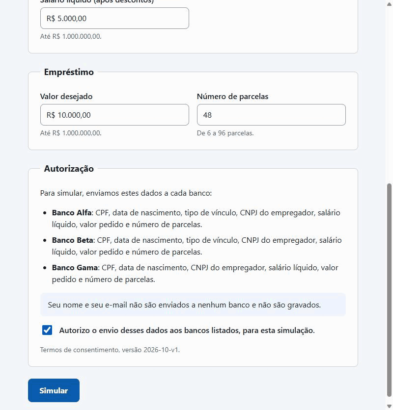
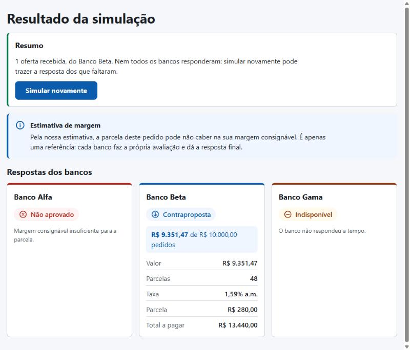
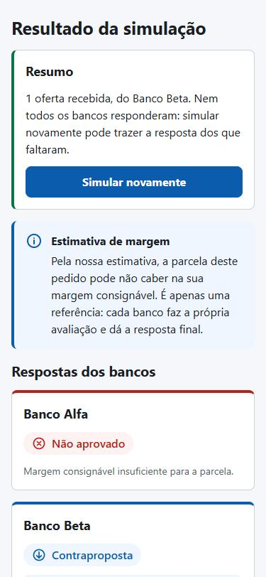
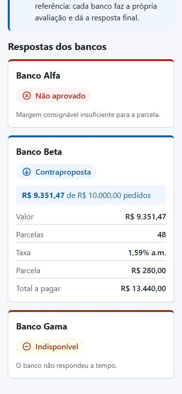
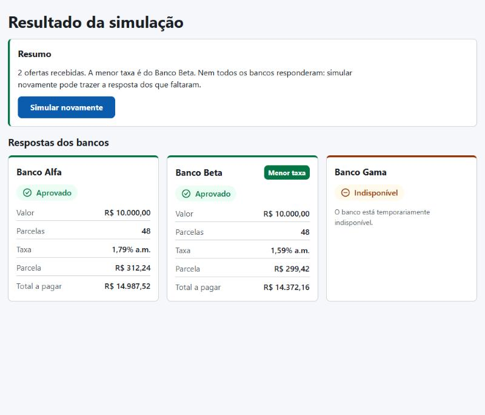

# Simulador de Empréstimo Consignado

> README em construção: docker-compose, arquitetura e a lista completa de variáveis de ambiente
> serão consolidados na etapa 7.



Simulação enviada pelo formulário numa janela de 800 px (por isso, cards em duas colunas), contra a
API e os bancos simulados reais: o Banco Alfa responde
em cerca de 1 s, o Beta em 3 s e o Gama, forçado a falhar (`x-mock-scenario: error`, 503 com
`Retry-After`), fica indisponível depois da nova tentativa. Só para a gravação, a latência do Beta
foi elevada (`BETA_LATENCY_MIN_MS=2000`, `BETA_LATENCY_MAX_MS=2500`), para que os cards cheguem
um de cada vez.

## Pré-requisitos

- **Para rodar com Docker:** Docker Desktop atualizado (no Linux, Docker Engine com o plugin
  Compose v2). No Windows, o Docker Desktop precisa do **WSL 2**: com uma versão antiga do Docker
  Desktop ou sem o WSL 2, o motor do Docker não sobe e o `docker compose` não consegue conectar.
- **Para o modo de desenvolvimento:** Node 24 ou mais recente.

## Como rodar com Docker

Na raiz do repositório:

```bash
docker compose up -d --build --wait
```

Depois, acesse **<http://localhost:8080>**. O `--wait` só devolve o terminal quando a API e o
front passam no healthcheck. Só a porta 8080 fica aberta no host: o nginx serve o front e repassa
`/api/` para a API, e a API e os bancos simulados ficam só na rede interna do compose.

Para parar, `docker compose down`. O banco SQLite fica num volume e sobrevive; `docker compose
down -v` apaga os dados.

## Verificação

Os comandos abaixo são de bash (no Windows, Git Bash ou WSL) e rodam na raiz do repositório.

### Smoke test

Confere o sistema no ar de ponta a ponta: lê o catálogo (`GET /banks`), cria uma simulação com o
cliente fictício dos testes (nenhum dado pessoal real), acompanha o resultado por até 30 s e valida
cada resposta pelos schemas do `shared`. Termina com código 0 quando passa e 1 quando falha,
dizendo em qual passo e por quê. Com o compose no ar, de duas formas:

```bash
npm run smoke
```

```bash
docker compose --profile smoke run --rm smoke
```

A primeira usa o Node da máquina (depois do `npm install`) e chama `http://localhost:8080/api`,
passando pelo nginx; `SMOKE_BASE_URL` troca o endereço (no modo de desenvolvimento,
`http://localhost:5173/api`). A segunda roda o mesmo script num container, só com Docker.

Um banco reprovar, ficar indisponível ou devolver erro não reprova o smoke, porque os bancos
simulados sorteiam falhas. Ele falha quando o sistema falha: resposta fora do schema, simulação
que não termina no prazo, banco ainda pendente no fim, bancos diferentes dos do catálogo ou
nenhum banco com resposta de fato (aprovação ou reprovação), sinal de que os bancos simulados
podem nem ter subido.

### Desligamento com uma simulação em andamento

Confere o [desligamento em duas fases](#desligamento-em-duas-fases) no pior caso: o Banco Gama
forçado a não responder (`timeout`), ainda em andamento durante toda a drenagem.

1. Suba o compose com a Gama em `timeout` (no PowerShell, defina antes
   `$env:BANK_GAMA_EXTRA_HEADERS='{"x-mock-scenario":"timeout"}'`):

   ```bash
   BANK_GAMA_EXTRA_HEADERS='{"x-mock-scenario":"timeout"}' docker compose up -d --wait
   ```

2. Crie uma simulação e pare a API logo em seguida, cronometrando. O `consentVersion` é o que
   `GET /api/banks` devolve; os dados são os do cliente fictício dos testes.

   ```bash
   curl -s -X POST http://localhost:8080/api/simulations -H 'content-type: application/json' -d '{"name":"Maria Teresinha Sauro","email":"maria.sauro@example.com","cpf":"52998224725","birthDate":"1985-04-12","employmentType":"PUBLIC_SERVANT","employerCnpj":"12ABC34501DE35","netSalaryCents":734219,"requestedAmountCents":1000000,"installments":48,"consent":true,"consentVersion":"2026-10-v1"}'; time docker compose stop api
   ```

   A parada precisa vir em até uns 6 s depois do POST. O orçamento da Gama é de 12 s; se sobrar
   menos que a drenagem (6 s) quando ela começa, a Gama estoura o próprio timeout durante a
   drenagem e o resultado é o do timeout normal, sem passar pelo cancelamento.

3. Confira o código de saída e o log do desligamento:

   ```bash
   docker compose ps -a --format '{{.Service}}: {{.State}}, código de saída {{.ExitCode}}' api
   docker compose logs api --since 2m
   ```

4. Religue a API e consulte a simulação, com o `id` que o POST devolveu:

   ```bash
   docker compose start api
   curl -s http://localhost:8080/api/simulations/<id>
   docker compose logs api --since 1m
   ```

5. Volte ao normal (sem a variável, o compose recria a API sem o cenário):

   ```bash
   docker compose up -d --wait
   ```

Medido em 24/10/2026, com Docker Desktop 29.9.2 no Windows 11:

| O que conferir              | Esperado                                                    | Medido                                                                                    |
| --------------------------- | ----------------------------------------------------------- | ----------------------------------------------------------------------------------------- |
| Do POST ao `stop`           | logo em seguida                                             | 0,21 s                                                                                    |
| `docker compose stop api`   | menos de 10 s                                               | 6,94 s                                                                                    |
| Código de saída da API      | 0 (137 = o Docker precisou matar o processo)                | 0                                                                                         |
| Simulação depois de religar | Gama UNAVAILABLE com "Tente novamente."; Alfa e Beta finais | Alfa e Beta APPROVED; Gama UNAVAILABLE, "O banco não respondeu a tempo. Tente novamente." |
| Log do boot seguinte        | nenhuma linha `expired PENDING bank results`                | nenhuma                                                                                   |

O log da API nessa execução, com o tempo contado a partir do SIGTERM:

| Tempo  | Linha do log                                           | O que marca                                                      |
| ------ | ------------------------------------------------------ | ---------------------------------------------------------------- |
| 0,00 s | `shutting down` (`signal: SIGTERM`)                    | início da drenagem: POST passa a responder 503, o GET continua   |
| 0,27 s | `bank answered` (Beta, APPROVED)                       | uma chamada em andamento termina dentro da drenagem              |
| 6,00 s | `bank did not answer` (Gama, `failure: ABORTED`)       | fim da drenagem (`SHUTDOWN_DRAIN_MS`): a Gama é cancelada        |
| 6,01 s | `bank calls finished` (`drained: false`, `aborted: 1`) | o resultado cancelado foi gravado                                |
| 6,02 s | `shutdown complete`                                    | HTTP e banco de dados fechados; é a última linha antes do exit 0 |

A API só sai depois de o logger esvaziar o buffer (`flushThenExit`): o stdout do pino é assíncrono,
e sem isso o `shutdown complete` poderia se perder no `process.exit`. Os quase 7 s da parada são
os 6 s de drenagem mais o fechamento e o tempo do próprio Docker.

O código 0 e a frase com "Tente novamente." são o que provam que o desligamento rodou. Se o sinal
não chegasse ao Node, o Docker o mataria aos 10 s (137) e, no boot seguinte, a
[expiração de PENDING](#pending-nunca-fica-para-sempre-decisão-e3) tiraria a Gama de PENDING do
mesmo jeito, mas com outra frase ("O banco não respondeu a tempo.") e uma linha
`expired PENDING bank results` no log.

## Como rodar em desenvolvimento

Cada comando abaixo roda num terminal próprio, na raiz do repositório.

```bash
npm install                                # também gera o client do Prisma
npm run db:migrate -w @simulador/api       # cria o SQLite em apps/api/data
npm run dev -w @simulador/mock-banks       # bancos simulados nas portas 4001, 4002 e 4003
npm run dev -w @simulador/api              # API na porta 3000
npm run dev -w @simulador/web              # front em http://localhost:5173
```

O front chama a API em `/api`, na própria origem. Em desenvolvimento, o servidor do Vite repassa
`/api/*` para `API_PROXY_TARGET` (padrão `http://localhost:3000`), sem o prefixo; em produção, um
proxy reverso faz o mesmo. Por isso não há CORS no caminho e o `Retry-After` das respostas fica
legível. `VITE_API_URL` troca a base (padrão `/api`) e é lida no build.

### Forçar cenários dos bancos

A API envia headers extras a um banco quando recebe `BANK_<ID>_EXTRA_HEADERS` (JSON). Com o header
`x-mock-scenario`, o banco simulado responde o cenário pedido em vez de sortear:

```bash
BANK_GAMA_EXTRA_HEADERS='{"x-mock-scenario":"error"}' npm run dev -w @simulador/api
```

| `x-mock-scenario` | O banco simulado                                   | O card mostra                                                 |
| ----------------- | -------------------------------------------------- | ------------------------------------------------------------- |
| `ok`              | responde pela regra fictícia dele                  | Aprovado, Contraproposta ou Não aprovado                      |
| `timeout`         | não responde dentro do orçamento                   | Indisponível: "O banco não respondeu a tempo."                |
| `error`           | Alfa 500; Beta 502 em HTML; Gama 503 + Retry-After | Alfa: Erro na resposta. Beta e Gama: Indisponível, após retry |
| `malformed`       | JSON quebrado                                      | Erro na resposta: "O banco retornou uma resposta inválida."   |
| `invalid-shape`   | JSON válido, fora do contrato do banco             | Erro na resposta: "O banco retornou uma resposta inválida."   |

O log da API distingue os dois últimos ("bank sent malformed JSON" e "bank response does not
match its contract", com o campo que falhou). Sem o header, os bancos simulados sorteiam falhas
por `<BANCO>_FAILURE_RATE` (e `GAMA_MALFORMED_RATE`) e a latência por `<BANCO>_LATENCY_MIN_MS` e
`<BANCO>_LATENCY_MAX_MS`.

A contraproposta não precisa de cenário: o Banco Beta só atende servidores públicos e aposentados
do INSS e, quando a parcela não cabe em 35% do salário, oferece o maior valor que cabe.

### Capturas

**Simulação A** (salário de R$ 800,00, servidor público, R$ 10.000,00 em 48 parcelas, Gama
forçado a `error`): Alfa reprova por margem, Beta faz contraproposta, Gama fica indisponível. Com
uma única oferta não há selo "Menor taxa", e o aviso de margem aparece porque a parcela estimada
não cabe.



<p>
  
  
</p>

**Simulação B** (salário de R$ 5.000,00, mesmo pedido): Alfa e Beta aprovam o valor integral; o
selo "Menor taxa" vai para o Beta (1,59% contra 1,79% ao mês).



## Decisões de projeto

### Margem consignável: a API informa, não bloqueia (decisão A1)

A API estima a margem consignável (percentual **fictício e configurável** do salário líquido) e a
parcela do valor pedido a uma **taxa de referência fictícia**. Essa estimativa serve apenas para
**informar** o cliente: a simulação é sempre enviada aos bancos.

Motivos:

- A estimativa não conhece os descontos que o cliente já tem em folha, o percentual real por tipo
  de vínculo nem a taxa de cada banco. Bloquear com base nela geraria falsos negativos definitivos.
- Bloquear eliminaria contrapropostas: um banco pode aprovar um valor menor que cabe na margem.
- Os bancos são a autoridade sobre a aprovação; o objetivo do sistema é interpretar as respostas
  deles.

O aviso exibido ao cliente deve deixar explícito que se trata de uma **estimativa** e que **os
bancos fazem a avaliação final**. O `GET` devolve só `fitsMargin` (veja "Dados pessoais"), então o
aviso não mostra valores. Texto previsto quando a parcela estimada não cabe:

> Pela nossa estimativa, a parcela deste pedido pode não caber na sua margem consignável. É apenas
> uma referência: cada banco faz a própria avaliação e dá a resposta final.

### Proposta planejada: bloqueio só de casos impossíveis (A3)

Evolução considerada: continuar informando sempre, mas bloquear antes de consultar os bancos
quando o pedido for **impossível** (por exemplo, parcela estimada maior que o salário líquido
inteiro). Reduziria consultas inúteis — que no mundo real podem ter custo e ficar registradas em
bureaus de crédito — sem eliminar contrapropostas. Exige definir e justificar o limite.

### Melhor oferta: menor taxa mensal (decisão B1)

A melhor oferta é a de **menor taxa mensal** entre as aprovadas, incluindo contrapropostas. A
parcela não é critério: uma contraproposta tem parcela menor só porque empresta menos dinheiro.
Desempates, em ordem: valor integral antes de contraproposta, maior valor aprovado e, por fim,
`bankId` em ordem alfabética (resultado independente da ordem de chegada das respostas).

### Retry: lista de permissão e Retry-After exato

Só se tenta de novo o que está numa **lista de permissão** de falhas transitórias: timeout da
tentativa, erro de rede e os status 502, 503 e 504. Qualquer outro resultado — inclusive um tipo
de falha criado no futuro — não é repetido até alguém decidir que deve ser.

Sem `Retry-After`, a espera é um backoff exponencial com _full jitter_. Com `Retry-After`, a
espera é **exatamente** o valor pedido pelo banco, desde que caiba no tempo restante da consulta.

### Dados pessoais gravados (minimização)

O `SimulationInput` completo existe **só em memória**, durante a consulta aos bancos. No banco de
dados ficam apenas:

| Dado                                    | Gravado?            | Por quê                                                                        |
| --------------------------------------- | ------------------- | ------------------------------------------------------------------------------ |
| CPF                                     | Só mascarado        | `***.982.247-**` permite ao cliente reconhecer a simulação, não identificá-lo  |
| Nome e e-mail                           | Não                 | Exigidos pelo enunciado, mas nenhum banco os recebe: validados e descartados   |
| Nascimento, vínculo, CNPJ do empregador | Não                 | Só os bancos usam                                                              |
| Salário líquido                         | Não                 | —                                                                              |
| Margem e parcela estimadas              | Sim, nunca expostas | Junto com o percentual revelam o salário exato: não saem no `GET` nem nos logs |
| Valor pedido e parcelas                 | Sim                 | Identificar contraproposta e mostrar o resultado                               |
| Momento e versão do consentimento       | Sim                 | Comprovar a base legal da consulta e a qual texto o cliente concordou          |
| Resultados dos bancos                   | Sim                 | É o produto                                                                    |

O `GET /simulations/:id` não tem autenticação: o UUID aleatório é a única chave. Por isso ele
devolve, da avaliação de margem, **só** `fitsMargin`. Margem, parcela estimada ou percentual de
comprometimento permitiriam recalcular o salário a partir do valor pedido e da configuração
pública; um teste garante que salários diferentes produzem respostas idênticas.

Logs: sem corpo de requisição, sem IP do cliente, com `redact` do pino para CPF, nome, e-mail,
nascimento, salário, CNPJ e margem. O `simulationId` liga os logs da requisição aos dos bancos.

### Consentimento: quais dados vão para quais bancos

O formulário monta o texto do consentimento a partir de `GET /banks`, que devolve a versão vigente
do texto (`CONSENT_VERSION`) e, por banco, o nome e os campos que ele recebe:

| Banco      | Recebe                                                                                                                         |
| ---------- | ------------------------------------------------------------------------------------------------------------------------------ |
| Banco Alfa | CPF, data de nascimento, tipo de vínculo (se informado), CNPJ do empregador, salário líquido, valor pedido, número de parcelas |
| Banco Beta | Os mesmos dados do Banco Alfa                                                                                                  |
| Banco Gama | Os mesmos, sem o tipo de vínculo (o contrato do Gama não tem esse campo)                                                       |

Nome e e-mail não vão para nenhum banco e não são gravados.

- **A lista é declarada por cada adapter**, ao lado do `toRequestBody`. Um teste confere a
  declaração pelo comportamento: muda um campo por vez e verifica se o corpo enviado ao banco muda.
  Campo enviado e não declarado, ou declarado e não enviado, quebra a suíte.
- **O front devolve a versão do texto que mostrou** (`consentVersion`) e o schema só aceita a
  vigente. Uma aba aberta antes de um deploy que mudou o texto recebe 400 pedindo para recarregar,
  em vez de gravar o aceite de um texto que o cliente não leu.
- **Mudar o nome de um banco ou seus campos exige versão nova.** Um teste guarda a declaração de
  cada versão e falha se a declaração mudar sem versão nova. Protege contra esquecimento, não contra
  má-fé: nada impede editar a entrada de uma versão já publicada.

### Hora do servidor e nome dos bancos vêm da API

- **`serverTime` no `GET /simulations/:id`.** O tempo decorrido de um banco que ainda não respondeu
  é medido contra o relógio do servidor, o mesmo que gravou `createdAt`. O front calcula, a cada
  resposta, a diferença entre o relógio do servidor e o do navegador, que pode estar minutos errado.
- **`bankName` em cada resultado**, vindo do registro de bancos da API. O front não tem lista de
  bancos: adicionar um banco continua sendo adapter + registro (e uma versão nova do
  consentimento). Um banco removido do registro aparece pelo id nas simulações antigas.

### Proposta planejada: link da simulação por e-mail

O e-mail é exigido pelo enunciado, mas hoje é só validado e descartado. Uso planejado: enviar ao
cliente o link de `/simulacoes/:id`, para ele voltar ao resultado depois ou em outro dispositivo,
com o link expirando junto com a retenção dos dados (também planejada). Exige:

- guardar o e-mail só até o envio (fila que apaga o endereço depois de entregar);
- uma versão nova do consentimento dizendo esse uso;
- aceitar que o link dá acesso ao resultado sem autenticação, como já acontece com quem tem o
  UUID: por isso o `GET` não devolve nada pessoal além do CPF mascarado.

### PENDING nunca fica para sempre (decisão E3)

Um banco que ainda está `PENDING` depois do maior orçamento de tempo entre os bancos mais uma folga
(`SIMULATION_PENDING_TTL_MS`, padrão 22 s) vira `UNAVAILABLE`. Isso é feito em dois momentos: no
`GET` (o cliente nunca vê um PENDING eterno) e ao iniciar a API (limpa o que um processo anterior
deixou). A gravação é condicional, então um resultado real que chegue ao mesmo tempo prevalece.

### Desligamento em duas fases

Ao receber `SIGTERM`: (1) a API deixa de aceitar novas simulações (`POST` responde 503) e espera
as consultas em andamento por até `SHUTDOWN_DRAIN_MS`; o `GET` continua respondendo; (2) cancela o
que restou, gravando "O banco não respondeu a tempo. Tente novamente.", e espera até
`SHUTDOWN_ABORT_GRACE_MS` por essas gravações. A soma é validada no boot para caber nos 10 s do
`docker stop`.

### Imagens Docker: o CLI do Prisma vai na imagem da API

Um único `Dockerfile`, na raiz, gera uma imagem por serviço sobre `node:24.14.1-trixie-slim`
(328 MB). A base é glibc, não Alpine: o better-sqlite3 e o motor de migrações do Prisma são
binários nativos pré-compilados para glibc.

- **API: 864 MB.** A cada boot, a API roda `prisma migrate deploy` antes de subir o servidor. Por
  isso o CLI do Prisma está na imagem (`prisma` fica em `dependencies`, não em `devDependencies`),
  e ele responde por cerca de 150 MB: o pacote `prisma` com as dependências que ficam junto dele
  (87 MB), o Prisma Studio (43 MB) e o motor de migrações (24 MB). O servidor não usa nenhum deles.
- **Alternativa: um serviço de migração de execução única.** Um serviço `migrate` no compose,
  feito a partir da imagem de build, rodaria o `migrate deploy` e terminaria; a API subiria
  depois dele (`depends_on` com `condition: service_completed_successfully`), numa imagem sem o
  CLI. O custo é a garantia: com a migração no comando da própria API, qualquer forma de subir a
  imagem (compose, `docker run`, um orquestrador) migra antes de servir; com o serviço à parte,
  quem sobe só a API pode apontá-la para um banco sem as migrações.
- **Bancos simulados: 385 MB.** Eles representam serviços de outra empresa (nem importam o
  `shared`), então a imagem leva só as dependências de produção deles: um `npm ci --omit=dev`
  restrito ao workspace, com 51 MB de `node_modules` em vez dos 326 MB do monorepo inteiro.

### Proposta planejada: tentar de novo só um banco (R3)

Primeira evolução planejada: `POST /simulations/:id/banks/:bankId/retry` para um banco que ficou
`UNAVAILABLE` ou `ERROR`, **sem guardar dados pessoais**. O front reenvia os dados que ainda tem no
formulário; a API guarda na criação só um HMAC desses dados (irreversível) e confere que o reenvio
é da mesma simulação. Exige: a linha do banco voltar de final para `PENDING` (coluna de versão e
proteção contra retry duplo), expiração por linha (`pendingSince`) em vez da data da simulação, e
decidir quando reaproveitar o `Idempotency-Key` (após timeout, reaproveitar devolve o resultado que
o banco talvez já tenha processado). Hoje, "Simular novamente" reenvia o formulário inteiro.

### Melhoria planejada: jitter sobre o Retry-After

Se muitos clientes recebem o mesmo `Retry-After: 2` ao mesmo tempo, todos voltam juntos dois
segundos depois e podem derrubar o banco de novo. A melhoria é somar um pequeno jitter ao valor
pedido (por exemplo, até 10% a mais), **nunca menos** que o `Retry-After`, para respeitar o banco
e ainda assim espalhar as tentativas.

### Front-end (etapa 6)

- **Sem bibliotecas de formulário nem de requisição.** O formulário tem estado próprio: no
  react-hook-form, as máscaras exigiriam `Controller` em metade dos campos, e o schema do shared
  valida o `SimulationInput`, não o estado da tela. O polling é um hook próprio: o
  `refetchInterval` do TanStack Query é um `setInterval`, e aqui a regra é nunca ter duas
  requisições em andamento. Estilo com CSS Modules e tokens (`tokens.css`), sem biblioteca de
  componentes: a acessibilidade fica no código do projeto, não dentro de uma dependência.
- **Máscaras que espelham o shared.** CPF e CNPJ aceitam só o que o shared aceita (CNPJ
  alfanumérico, maiúsculas só em `a-z`). Dinheiro é digitado em centavos e formatado sem passar
  por float: divisão de `BigInt` e uma string decimal entregue ao `Intl`.
- **Cliente da API que nunca rejeita.** Cada chamada devolve um resultado discriminado (`ok`,
  `validation`, `rate-limited`, `unavailable`, `not-found`, `network`, `unexpected` ou `aborted`),
  como o `BankProvider` faz com os bancos. Toda resposta passa pelo schema do shared; o que não
  passa vira `unexpected`.
- **Polling encadeado.** Cada resposta agenda a próxima consulta, então nunca há duas ao mesmo
  tempo e uma resposta lenta adia a seguinte em vez de empilhar requisições. Espera: 1 s no caminho
  normal; 1, 2, 4 e 8 s após falhas seguidas; com `Retry-After` (429 ou o 503 do desligamento), o
  valor pedido, com piso de 1 s e teto de `MAX_RETRY_AFTER_MS` (veja abaixo). O polling para
  quando nenhum banco está `PENDING` ou num 404. Ao sair da página, o timer é cancelado e a
  requisição em andamento é abortada.
- **Uma falha no polling não apaga o resultado.** Em erro de rede, 5xx, 429 ou resposta inválida,
  a tela mantém o último estado e mostra um aviso neutro ("Não foi possível atualizar o resultado
  agora. Tentando novamente…"): num 429 ou num 5xx a conexão do cliente está boa, e o aviso não
  deve culpá-la.
- **Cards por banco, na ordem da API, com o nome vindo dela.** Cada estado tem cor, ícone e texto
  (Aguardando resposta, Aprovado, Contraproposta, Não aprovado, Indisponível, Erro na resposta):
  nenhum depende só de cor. A contraproposta tem destaque próprio ("R$ X de R$ Y pedidos"), e o
  motivo que a API dá (`reason`) aparece sempre que vier.
- **Selo "Menor taxa" só no fim e com duas ofertas ou mais.** Durante a consulta, o `bestOffer`
  é a melhor oferta até aquele momento; mostrar o selo antes faria ele pular de banco quando um
  mais lento responde. Com uma única oferta não há o que comparar.
- **Resumo: "não" é diferente de "não sei".** A frase só afirma o que as respostas dos bancos
  sustentam, e o link de volta ao formulário muda conforme o caso:

  | Situação                                    | Resumo                                                                                                          | Link                      |
  | ------------------------------------------- | --------------------------------------------------------------------------------------------------------------- | ------------------------- |
  | Consultando                                 | "Consultando os bancos: 2 de 3 responderam."                                                                    | —                         |
  | Duas ofertas ou mais                        | "2 ofertas recebidas. A menor taxa é do Banco Beta."                                                            | Ajustar e simular de novo |
  | Uma oferta                                  | "1 oferta recebida, do Banco Beta."                                                                             | Ajustar e simular de novo |
  | Sem ofertas, algum banco reprovou           | "Nenhum banco aprovou o pedido."                                                                                | Ajustar e simular de novo |
  | Algum banco sem resposta, nos 3 casos acima | O texto do caso + "Nem todos os bancos responderam: simular novamente pode trazer a resposta dos que faltaram." | Simular novamente         |
  | Nenhum banco respondeu                      | "Nenhum banco respondeu. Simular novamente pode trazer as respostas."                                           | Simular novamente         |
  | Simulação inexistente ou expirada (404)     | "Simulação não encontrada ou expirada."                                                                         | Fazer uma nova simulação  |

  "Simular novamente" fica em destaque porque os mesmos dados podem trazer a resposta dos bancos
  que faltaram; quando todos responderam, repetir os dados daria a mesma resposta, por isso o
  convite é para ajustar.

- **Leitor de tela.** Uma região `aria-live` existe vazia desde o primeiro render (uma região que
  nasce junto com o texto não é anunciada). Ela anuncia o resumo na primeira resposta, cada banco
  que responde ("Banco Beta: contraproposta.") e, no fim, o resumo. O contador de segundos fica
  fora dela. O aviso de falha é `role="alert"` e, vazio, nunca usa `display: none`, que o tiraria
  da árvore de acessibilidade. Ao trocar de rota, o foco vai para o `<h1>` da página.
- **Rascunho só em memória.** "Simular novamente" volta ao formulário preenchido, mas pede o
  consentimento de novo, e nada é gravado no navegador: CPF e salário não ficam no `localStorage`.

### Proposta implementada: teto único para o Retry-After

`MAX_RETRY_AFTER_MS` (60 s), no `packages/shared`, é a fonte única do maior `Retry-After` aceito.
O front nunca espera mais que isso entre duas consultas, e a API recusa no boot uma
`RATE_LIMIT_WINDOW_MS` maior, porque o `Retry-After` de um 429 dura até o fim da janela. Assim, um
`Retry-After` legítimo da nossa API nunca é cortado, em qualquer configuração; o teto só corta
valores que não vieram dela (um proxy mal configurado, por exemplo).

O teto também protege o `setTimeout`: acima de 2³¹ − 1 ms, ou com `Infinity`, o timer dispara na
hora, e o polling entraria em loop justamente contra um servidor que pediu para esperar. Um teste
da rota roda com a janela máxima e confere que o `Retry-After` enviado pelo `@fastify/rate-limit`
cabe no teto.

### Proposta planejada: Retry-After em data HTTP

Hoje o front só entende `Retry-After` em segundos, que é o formato que a API envia. Em formato de
data, a espera seria calculada contra o relógio do navegador, que pode estar minutos errado. A
evolução é converter a data com a diferença entre o relógio do servidor (o header `Date` da própria
resposta) e o do navegador, a mesma correção já usada no tempo decorrido.

## Limitações

### Rate limit contra IP forjado: uma camada só

O rate limit conta as requisições por IP do cliente (padrão: 10 POSTs por minuto). Atrás do
nginx, a API lê esse IP do `X-Forwarded-For` (`TRUST_PROXY=true`), e a proteção contra um IP
forjado nesse cabeçalho depende de duas condições:

- **O nginx sobrescreve o `X-Forwarded-For`** com o endereço que ele viu (`$remote_addr`), em vez
  de acrescentar. Dois testes provam isso. Pelo nginx do compose, 11 POSTs, cada um com um IP
  forjado diferente, levam o 11º a 429: o contador é um só. Num nginx que acrescenta
  (`$proxy_add_x_forwarded_for`), 15 POSTs iguais passam sem nenhum 429, porque cada IP forjado
  ganha um contador novo.
- **O nginx é o único caminho até a API:** a porta dela não é publicada no host. Quem chegasse
  direto poderia mandar qualquer `X-Forwarded-For`.

Uma segunda camada seria a API confiar só no IP do nginx (`trustProxy` com o endereço dele).
Confiar na sub-rede inteira do compose não adiantaria: o nginx vê o host como o gateway dessa
mesma rede. Seria preciso fixar uma sub-rede e o IP do nginx no compose, e uma sub-rede fixa pode
colidir com redes já existentes na máquina de quem roda o projeto; por isso ficou de fora. Em
produção, a lista de proxies confiáveis viria da infraestrutura.

Confiar num número de saltos (`trustProxy: 1`) não é alternativa: o Fastify (5.12.7, a versão
usada) desativou essa opção porque ela não confere quem é o vizinho imediato, e um cliente que
chegasse direto à API forjaria o IP.
